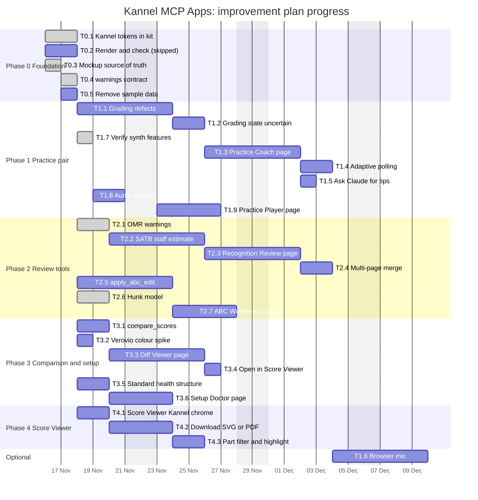

# MCP Apps improvement plan (after PR #192)

**last changed:** 2026-11-11
**source:** https://github.com/raulkivi/sheet-music-mcp

**Status:** Plan, not started. Input: Kannel interactive mockups merged in
[#192](https://github.com/raulkivi/sheet-music-mcp/pull/192) (`docs/design/interactive/`), the visual
system in [docs/design/design-system.md](../design/design-system.md), and the gap review of the
server tools and apps. Owner decisions are in [§6](#6-decisions-needed-from-the-owner).

---

## 1. Summary

- Only one app is shipped: the Score Viewer (render-mcp, spike). Six pages exist only as mockups.
- Server-side plumbing exists for all six apps (`ui://` resources, `meta.ui`, app-only helpers).
  Five servers register Setup Doctor resources with no page source.
- The mockups are clickable, but they hard-code sample data and some behaviour the engines do not
  yet provide. Building them as-is would ship fake issues, fake states and a fake meter.
- Kannel tokens are not in the kit yet (`ui/packages/kit/src/theme.ts` has no Kannel values).
- Nothing in the mockups has been rendered in a browser yet (PR #192 says so).

**Order:** make the mockups honest and the tokens real (Phase 0), then build the practice pair
(Phase 1, the P0 apps), then the review tools that depend on new server contracts (Phase 2), then the
comparison and setup pages (Phase 3).

---

## 2. Baseline

| App | Server | Server side | Mockup (#192) | Page in `ui/apps/` | Blocking gaps |
|---|---|---|---|---|---|
| Score Viewer | render-mcp | `render_page_svg` app-only; `render_to_pdf` / `render_to_image` linked | Yes | **Shipped** (spike) | No Kannel chrome; download plan unclear (SVG vs PDF); no part filter |
| Practice Coach | pitch-mcp | `get_score_for_session`, `push_audio_chunk`, `list_sessions`, `start_practice` | Yes | No | Grading defects open (xfail); no real data binding; no report mode |
| Practice Player | synth-mcp | `read_audio_chunk`, `get_score_xml`, `part_gains`, `starting_pitches` | Yes | No | Mock is on/off toggles, not solo/mute/volume; no audio delivery |
| Recognition Review | omr-mcp | `get_recognized_score`, `get_source_preview` | Yes | No | No `warnings[]` (C4); no staff estimate (C1); issues are hard-coded |
| ABC Workbench | musicxml-abc-mcp | `get_abc` (by `abc_id`), `validate_abc` | Yes | No | `apply_abc_edit` (C16) missing; hunk model not in code |
| Diff Viewer | comparer-mcp | `compare_musicxml*`, `list_changes`, `export_annotated_musicxml` | Yes | No | `compare_scores` (C24) not exposed; Verovio colour support unverified |
| Setup Doctor | all six | `health_check` text, `ui://<server>/setup-doctor` registered | Yes (one board, three servers) | No | Mock aggregates servers; each server can only show its own checks |

---

## 3. Mockup-to-code gaps

These must be settled before a page is built. Each row is a place where the mockup promises
behaviour the server or the design system does not support.

| # | App | Mockup shows | Reality or rule | Resolution |
|---|---|---|---|---|
| G1 | Recognition Review | Issue list: "Bar 12, alto: three notes read" hard-coded, "Re-run with this engine" | No `warnings[]` on omr results; issues must come from the server | Build C4 warnings first (T3.1); page reads them |
| G2 | Recognition Review | "Audiveris (keeps SATB)" as a fixed choice | SATB detection needs `staff_systems_estimate` (C1, not built) | Treat the warning as data; mock copy stays until T3.2 lands |
| G3 | Practice Coach | Statuses `ok / flat / slip` ("Octave slip", "Flat on beat 3") | Octave-slip and vibrato grading are open xfail defects | Show `uncertain` / "no signal" when the engine cannot grade; do not show a confident "slip" |
| G4 | Practice Coach | Simulated meter cycle; sample bar 9–12 | No binding to `get_current_position` / `push_audio_chunk` | Real adaptive polling (D7); remove the cycle |
| G5 | Practice Coach | No mic-source choice | Decision D2: server mic (A) first, browser mic (B) later | Add a source selector; default to server mic |
| G6 | Practice Coach | No "Ask Claude for tips", no report mode | Plan §5.1 Report mode and `ui/message` | Add both (T1.4) |
| G7 | Practice Player | Parts are on/off toggles; tempo copy says "re-renders the track" | Plan: solo / mute / volume, presets (D3); tempo is local first (`playbackRate`), re-render only on voice change | Change copy; implement local tempo |
| G8 | Practice Player | Loop "bars 17 to 24" hard-coded; tempo 50–120 BPM with 84 as written | `measures` (B2) and `tempo_factor` 25–400 % exist as contract | Bind loop to `measures`; use the server's tempo range |
| G9 | Practice Player | Count-in toggle | C10 status unverified | Confirm in code; wire or hide |
| G10 | ABC Workbench | Single hunk, "Valid ABC" text fixed | Hunk model needs C16 and `validate_abc` live | Pure hunk merge (T4.2); live validation (T4.3) |
| G11 | ABC Workbench | Accept "writes MusicXML" | `abc_to_musicxml` returns MusicXML; path policy (A1) decides how it is saved | Write via `return: auto` and show a file chip |
| G12 | Diff Viewer | "Open in Score Viewer" implies a direct link | Apps cannot call other servers (spec §2) | Post `ui/message`; the model chains (decision DA8) |
| G13 | Diff Viewer | Kinds: Pitch, Rhythm, Lyrics, Dynamics | Kinds must match the comparer's real diff model; Articulation is absent | Take kinds from `structuredContent`, not a fixed list |
| G14 | Setup Doctor | One board for render, synth, omr | Each server serves its own `ui://<server>/setup-doctor` | One component in core, per-server data (DA5) |
| G15 | Score Viewer | "Download SVG" | Plan uses `get_pdf(pdf_id)` for PDF | Decide DA2 |
| G16 | All | Two mockup sets: `docs/design/mockups/` (static) and `interactive/` | Duplicated, will drift | One source of truth (DA1) |
| G17 | All | Kannel tokens, tricolour, focus ring | Not in kit; `design-system.md` §11 D3 | Adopt in the kit (T0.1) |
| G18 | All | Sample data inline | Must come from tool results or `structuredContent` | Remove sample data before shipping |
| G19 | All | Icons: cornflower, waveform "reserved, not drawn" | Design system §6 | Draw or drop before release |
| G20 | All | No reduced-motion behaviour in mocks | Design system §5 requires it | Add in each page (X1) |

---

## 4. Work plan

Each task has a complexity (low / medium / high) and the model it should run on. Test-first is
mandatory: each task starts with the failing test named in its acceptance column.

**Model rule:** Haiku for mechanical edits, Sonnet for typical feature work, Opus for cross-cutting
design or tricky logic. **Local model (setup6)** is used only where the rules in `CLAUDE.md` allow:
at most three files, an exact spec, acceptance tests the local agent does not see, and no domain
judgement. Local runs are marked "local candidate"; they are verified outside the VM.

### Phase 0: foundation (no new pages)

| ID | Task | Cx | Model | Local | Files | Acceptance (test first) |
|---|---|---|---|---|---|---|
| T0.1 | Adopt Kannel tokens in the kit (`theme.ts`, D3). Separate change: it moves Score Viewer contrast tests. | M | Sonnet | Candidate | `ui/packages/kit/src/theme.ts`, its test | `brand-tokens.test.ts` and `theme-contrast.test.ts` pass with the new values; Score Viewer e2e unchanged |
| T0.2 | Render all eight Kannel boards in a browser (Design runtime `support.js`), run axe and the contrast pairs, record results in the mockup README. | M | Sonnet | No | `docs/design/interactive/README.md` | Zero axe serious/critical issues per board; contrast pairs in §3.1 of the design system hold |
| T0.3 | Settle the mockup source of truth (DA1) and mark the other set as archived or generated. | S | Haiku | Yes | docs only | One README states the canonical set; links updated |
| T0.4 | Document the `warnings[]` contract (`{code, severity, message, measure?, part?}`) in `docs/conventions.md`. Needed by G1. | S | Sonnet | No | `docs/conventions.md` | Contract reviewed; used by T3.1 |
| T0.5 | Remove sample data from the mockups, keep the shape of each `structuredContent` as a fixture. | S | Haiku | Yes | `docs/design/interactive/*.dc.html` (≤3 per run) | Each board renders from a fixture file only; no inline sentences that look like data |

### Phase 1: practice pair (P0)

**Practice Coach (pitch-mcp)**

| ID | Task | Cx | Model | Local | Files | Acceptance |
|---|---|---|---|---|---|---|
| T1.1 | Fix the three open grading defects (octave slip, vibrato on held final note, long voiced tail). Remove the xfail markers when fixed. | H | Opus | No | `pitch-mcp` engine and grading tests | Existing xfail tests pass; no regression in 482 unit tests |
| T1.2 | Expose a grading state `uncertain` / `no_signal` in `get_current_position` and `structuredContent` (G3). | M | Sonnet | Candidate | `pitch-mcp` engine, presenter, tests | Test: low-confidence frame returns `uncertain`, never `slip` |
| T1.3 | Practice Coach page: score cursor from `get_score_for_session`, meter, Start / Stop, Report mode from `stop_monitoring` summary. Mic source selector (server mic, A). | H | Sonnet | No | `ui/apps/practice-coach/*` | Vitest: cents → needle, status map, history. Playwright on mock host: AC-P5 (cursor visits bars in order; meter colour per status); axe clean; 360 px; keyboard |
| T1.4 | Adaptive polling 5–10 Hz (D7); animate between samples; pause on hidden tab. | M | Sonnet | No | page polling module | Unit: back-off when median RTT > 80 ms; no request while hidden |
| T1.5 | "Ask Claude for tips" via `ui/message`; `update-model-context` on stop (G6). | S | Haiku | Candidate | page + 1 helper | Mock host records one `ui/message` with fixed template text (no MusicXML free text) |
| T1.6 | Browser mic (B): `AudioSource` protocol, `PushedChunkSource`, AudioWorklet capture. Phase 3 of the proposal; behind feature detection. | H | Opus | No | `pitch-mcp` engine, page | AC-P4 (220 Hz push → `on_pitch`); permission denied → falls back to A |

**Practice Player (synth-mcp)**

| ID | Task | Cx | Model | Local | Files | Acceptance |
|---|---|---|---|---|---|---|
| T1.7 | Verify `part_gains` presets (`learning`, `karaoke`, `equal`) and `measures`, `repeat`, `count_in_bars`, `timbre` in code; list what is missing (G9). | S | Haiku | Yes | none (report) | Written list in this doc §7 |
| T1.8 | Audio delivery: `read_audio_chunk` loop into a Blob; `audio_id` from `structuredContent`. | M | Sonnet | Candidate | page loader module | AC-S3: concatenated chunks byte-equal to WAV; unknown id → `INVALID_PARAMETER` |
| T1.9 | Practice Player page: solo / mute / volume per part (G7), tempo via `playbackRate` (`preservesPitch`), re-render on voice change, loop bound from `measures` (G8), playhead from Verovio timemap. | H | Sonnet | No | `ui/apps/practice-player/*` | AC-S5 (tempo 0.5 → loop start at 2× score time); AC-S1 engine test (CC7 = 0 for muted part); Playwright mock host; axe; reduced motion (playhead jumps by measure) |

### Phase 2: review tools (depend on server contracts)

**Recognition Review (omr-mcp)**

| ID | Task | Cx | Model | Local | Files | Acceptance |
|---|---|---|---|---|---|---|
| T2.1 | Emit `warnings[]` from `recognize_sheet*` (C4) using T0.4 contract. | M | Sonnet | Candidate | `omr-mcp` presenter, tests | Test: parts < staves produces a `warnings` entry; no warnings on a clean fixture |
| T2.2 | SATB detection: `metadata.staff_systems_estimate` (cheap staff-line projection). | H | Opus | No | `omr-mcp` image code, fixtures | AC-O3 fixture (`staves_detected: 1`, estimate 4 → warning shown). Integration on real samples (not in this container) |
| T2.3 | Recognition Review page: photo via `get_source_preview`, score via `get_recognized_score` + Verovio, engine switch → `recognize_sheet` with `engine`, issue list from `warnings[]` (G1), accept → `ui/message`. | H | Sonnet | No | `ui/apps/recognition-review/*` | AC-O1/AC-O2 (server); AC-O3 (UI); no hard-coded issues; axe |
| T2.4 | Multi-page reorder and merge (plan U3). Decide DA9 first. | M | Sonnet | No | page + merge call | Page order persists in model context; merge calls `recognize_sheets` once |

**ABC Workbench (musicxml-abc-mcp)**

| ID | Task | Cx | Model | Local | Files | Acceptance |
|---|---|---|---|---|---|---|
| T2.5 | `apply_abc_edit` (C16): replace measures of one part, keep other parts byte-for-byte. | H | Opus | No | `musicxml-abc-mcp` engine, tests | Round trip: other parts and dynamics unchanged; invalid bar range → `INVALID_PARAMETER` |
| T2.6 | Hunk model: pure TS merge of original and proposed lines; accept selected / reject all (G10). | M | Sonnet | Candidate | `ui/packages/kit/src/abc/hunks.ts`, test | AC-A1: accept all = proposed; accept none = original |
| T2.7 | ABC Workbench page: original via `get_abc(abc_id)`, proposed from tool input, live `validate_abc` at 300 ms, accept → `abc_to_musicxml`, file chip (G11). | H | Sonnet | No | `ui/apps/abc-workbench/*` | AC-A3 error marker within 500 ms; no fixed "Valid ABC" text; axe |

### Phase 3: comparison and setup

**Diff Viewer (comparer-mcp)**

| ID | Task | Cx | Model | Local | Files | Acceptance |
|---|---|---|---|---|---|---|
| T3.1 | Decide and expose the consolidated tool (C24 `compare_scores`) with aliases for one minor release. | M | Sonnet | No | comparer server, conventions | Old names still pass their tests; new tool has `output_schema` (AC-C1) |
| T3.2 | Spike: does Verovio apply MusicXML `color` on notes? If not, CSS on element ids. | S | Sonnet | No | spike script, findings note | Recorded answer in the proposal's open questions |
| T3.3 | Diff Viewer page: list from `structuredContent`, kind filters from the real model (G13), selection scrolls both panes, Report tab, export annotated scores. | H | Sonnet | No | `ui/apps/diff-viewer/*` | AC-C3 (click m.19 scrolls both panes); Playwright; axe; stack at 360 px |
| T3.4 | "Open in Score Viewer" posts `ui/message` (G12). | S | Haiku | Yes | page + 1 helper | Mock host records one `ui/message` |

**Setup Doctor (all servers)**

| ID | Task | Cx | Model | Local | Files | Acceptance |
|---|---|---|---|---|---|---|
| T3.5 | Standard `health_check` structure `{status, checks:[{name,status,version?,hint?,fix_snippet?,doc_url?}]}` in `sheet_music_mcp_core.health` and each server. | M | Sonnet | No | core `health.py`, six servers | Existing health tests pass; `output_schema` validates for all six |
| T3.6 | One Setup Doctor page built in core, fed by each server's own checks (G14). Copy report via `clipboardWrite`; install links via `ui/open-link`. | M | Sonnet | Candidate (page part) | `sheet-music-mcp-core` ui, page | Each server's `ui://<server>/setup-doctor` renders its own checks; axe; no cross-server claims |

### Phase 4: shipped Score Viewer and cross-cutting

| ID | Task | Cx | Model | Local | Files | Acceptance |
|---|---|---|---|---|---|---|
| T4.1 | Score Viewer chrome to Kannel: tricolour bar, focus ring, 40 px touch targets, theme tokens (after T0.1). | M | Sonnet | Candidate | `ui/apps/score-viewer/*` | Existing e2e green; new check for the tricolour and ring (design §9) |
| T4.2 | Download: SVG (mock) or PDF via `get_pdf` (DA2). | M | Sonnet | No | render-mcp server, page | PDF bytes start with `%PDF`; blob download fallback posts `ui/message` (D6) |
| T4.3 | Part filter and highlight (render `parts`, C6b) in the viewer. | M | Sonnet | No | render-mcp engine, page | AC-R3 paging; highlight dims other parts |
| X1 | Reduced motion, `aria-live` on cents and status, keyboard for every control. Added to each page task's spec, not a separate phase. | S | Haiku | Yes | page CSS, specs | Playwright with `reducedMotion: 'reduce'` |

---

## 5. Sequencing

| Step | Items | Exit criterion |
|---|---|---|
| 1 | T0.1–T0.5 | Tokens in kit; mockups rendered and checked; no sample data in mockups |
| 2 | T1.1, T1.2 (pitch engine) in parallel with T1.7, T2.1 | Grading state honest; warnings exist |
| 3 | T1.3–T1.5, T1.8, T1.9 | Practice pair running in the mock host |
| 4 | T2.2, T2.3, T2.5–T2.7 | Recognition review and ABC workbench in mock host |
| 5 | T3.1–T3.6, T4.x | Diff viewer, setup doctor, Score Viewer chrome |
| 6 | T1.6, T2.4 | Browser mic and multi-page (optional, after owner review) |

Each step ends with the full suites of the servers it touched, and the UI specs for each page. Server
docs are updated per the document policy in `CLAUDE.md` when a step lands.

### 5.1 Gantt chart

Durations are working days (weekends excluded). Bars are planned dates; once a task starts or
finishes, its tag and dates change to actuals (see §5.3). Start date is the planned kick-off.

### 5.2 Progress tracker

Status values: **Not started**, **Active**, **Done**, **Blocked** (with the blocker in Notes).
Dates are YYYY-MM-DD. Update this table with the Gantt chart after every step.

| ID | Task | Status | Started | Done | Notes |
|---|---|---|---|---|---|
| T0.1 | Kannel tokens in kit | Done | 2026-11-11 | 2026-11-11 | Branch `feat/kannel-tokens-kit` 46d5448, unpushed. ui: 270 unit, 61/61 e2e |
| T0.2 | Render and check boards | Skipped | | | Owner: skip browser checks; artboards checked on the published Design canvas |
| T0.3 | Mockup source of truth | Done | 2026-11-11 | 2026-11-11 | Branch `docs/mockup-source-of-truth` 316a801, unpushed. DA1 confirmed by owner |
| T0.4 | warnings contract | Done | 2026-11-11 | 2026-11-11 | Branch `docs/warnings-contract` abfaa0a, unpushed |
| T0.5 | Remove sample data | Not started | | | |
| T1.1 | Grading defects | Not started | | | Opus |
| T1.2 | Grading state uncertain | Done | 2026-11-11 | 2026-11-11 | PR #200, 494 passed. Thresholds (YIN 0.6, octave 100 cents) to review; T1.1 still open |
| T1.3 | Practice Coach page | Not started | | | DA7 open |
| T1.4 | Adaptive polling | Not started | | | |
| T1.5 | Ask Claude for tips | Not started | | | |
| T1.6 | Browser mic (optional) | Not started | | | Phase 4 |
| T1.7 | Verify synth features | Done | 2026-11-11 | 2026-11-11 | Report only, §7. All features exist |
| T1.8 | Audio delivery | Not started | | | |
| T1.9 | Practice Player page | Not started | | | DA3, DA4 open |
| T2.1 | OMR warnings | Done | 2026-11-11 | 2026-11-11 | PR #198, 318 passed. Owner decision: estimate now runs for all clients (see note) |
| T2.2 | SATB staff estimate | Not started | | | Opus; integration needs real samples |
| T2.3 | Recognition Review page | Not started | | | |
| T2.4 | Multi-page merge (optional) | Not started | | | DA9 open |
| T2.5 | apply_abc_edit | Done | 2026-11-11 | 2026-11-11 | PR #201, 306 unit + 6 integration. Open: `musicxml_to_abc` drops `=` naturals (separate task) |
| T2.6 | Hunk model | Done | 2026-11-11 | 2026-11-11 | PR #197, CI 24/24 pass, 283 unit tests |
| T2.7 | ABC Workbench page | Not started | | | |
| T3.1 | compare_scores | Not started | | | |
| T3.2 | Verovio colour spike | Not started | | | |
| T3.3 | Diff Viewer page | Not started | | | DA8 open |
| T3.4 | Open in Score Viewer | Not started | | | |
| T3.5 | Standard health structure | Done | 2026-11-11 | 2026-11-11 | Already on main via PR #178 (merged). Verified: core `health.py`, six servers return it with `output_schema`. No new PR |
| T3.6 | Setup Doctor page | Not started | | | DA5 open |
| T4.1 | Score Viewer Kannel chrome | Not started | | | |
| T4.2 | Download SVG or PDF | Not started | | | DA2 open |
| T4.3 | Part filter and highlight | Not started | | | |

### 5.3 Update rule

After every implementation step, before the next step starts:

1. Set each finished or started task's status in §5.2 and fill **Started** and **Done** with actual dates.
2. Mirror the status in §5.1: add `done` (finished) or `active` (in progress) to the task's tag, and
   replace its planned dates with actuals where they differ. If a task slips, move its `after` link
   or durations so the chart shows the real critical path.
3. Add a line to the log in §5.4: date, step, tasks, test result (suites run and counts), blockers.
4. Bump **last changed** in the header.
5. If scope changed, record it in §6 (decision) and reflect it in the Gantt and tracker in the same edit.

### 5.4 Progress log

| Date | Step | Tasks | Result | Blockers |
|---|---|---|---|---|
| 2026-11-11 | Plan created | none | Gantt and tracker added | none |
| 2026-11-11 | Phase 0 step 1 | T0.1, T0.3, T0.4 | Implemented on separate branches, reviewed. ui: 270 unit, 61/61 e2e; docs reviewed | Branches not yet merged |
| 2026-11-11 | Phase 1–2 batch 1 | T1.7, T2.1, T2.6 | T1.7 report (§7). T2.1 PR #198 (318 passed, 48 skipped). T2.6 PR #197 (283 passed). Open: T2.1 changes the staff estimate to run for all clients, with false positives on one-staff pages | T2.1 decision needed |
| 2026-11-11 | Batch 2 results | T2.1 fix, T1.2, §10, T2.5 | PR #198 severity now `info` (ff07c0d). T1.2 PR #200 (494 passed, 4 xfail kept). §10 docs PR #199. T2.5 PR #201 (306 unit, 6 integration; other parts byte-identical on 10 SATB samples). Open: T1.2 thresholds (YIN 0.6, octave 100 cents) need review; T2.5 open questions (bar-count strictness, lyrics carry-over, multi-staff `<staff>`); `musicxml_to_abc` drops `=` naturals (B natural exports as B flat) | T1.2 thresholds, T2.5 questions, naturals bug |
| 2026-11-11 | Interview decisions | T2.1, T1.9, T4.2 | Staff check: all clients, severity `info` (PR #198 to change). Practice Player: presets + per-part volume (DA3). Download: PDF and SVG (DA2). Next batch: T2.5, §10 docs PR, T1.2 | none |
| 2026-11-11 | T3.5 check | T3.5 | Already implemented on main via #178 (merged). No new work; T3.6 Setup Doctor page is now unblocked | none |
| 2026-11-11 | Interview 2 | naturals bug, T1.2, T2.5, next batch | Naturals bug: fix now, own PR. T1.2 thresholds: accept as is. T2.5: strict bar count, multi-staff as a whole, key/time/clef ignored in ABC; lyrics carry-over not chosen. Next: T1.1, T3.5, naturals; T1.3 waits for #200 merge; T2.2 needs real samples | none |
| 2026-11-11 | Owner answers | DA1, T0.2 | DA1 confirmed (`interactive/` canonical). T0.2 skipped (no `support.js`). §10 link change pending owner go-ahead | none |

---

## 6. Decisions needed from the owner

| # | Question | Recommendation |
|---|---|---|
| DA1 | Which mockup set is canonical: `docs/design/interactive/` or `docs/design/mockups/`? | `interactive/`; archive the static set |
| DA2 | Score Viewer download: SVG (mockup) or PDF (proposal `get_pdf`)? | Offer both: PDF for print, SVG for web |
| DA3 | Practice Player: solo/mute/volume with presets (proposal), or on/off toggles (mockup)? | Proposal: presets plus per-part volume |
| DA4 | Tempo: re-render on every change (mockup copy) or local `playbackRate` first (proposal)? | Local first; re-render only on voice change |
| DA5 | Setup Doctor: one board for all servers (mockup) or per server (proposal)? | Per server (the MCP Apps rule does not allow cross-server calls) |
| DA6 | Ship Estonian UI labels? (design system D4) | Ship English first; Estonian after the labels are final |
| DA7 | Practice Coach mic source for v1: server mic (A) only? | Yes, A only; B in Phase 4 |
| DA8 | Diff Viewer "open in Score Viewer": `ui/message` (chain through model). | Yes |
| DA9 | Recognition Review multi-page in v1? | No; single page first, multi-page in T2.4 |
| DA10 | Icons cornflower and waveform: draw now or drop? | Draw the waveform (Practice Player); drop the cornflower unless used |

---

## 7. Verification to do before Phase 1

- T1.7 result (2026-11-11, read-only, code not run): all synth features exist.
  - `part_gains`, `preset` (`learning`, `karaoke`, `equal`) with `focus_part`, `measures`, `repeat` (1–20), `count_in_bars` (0–4), `metronome`, `tempo_factor`, `starting_pitches` (`parts`).
  - `timbre` enum is `score` (default), `piano`, `choir`, `organ`. `score` is not in the mockup's list; the page must send one of the four.
  - `read_audio_chunk` and `get_score_xml` are app-only. Not verified that the page is served them.
  - Tests not run; gaps for T1.9 are the page, not the engine.
- Whether `start_practice` and `list_sessions` are wired to a page or are text-only.
- The three grading defects: check the xfail list in `pitch-mcp/docs/todo.md` is still current.

## 8. Rules applied

- TDD: each task names its first failing test.
- SOLID and CUPID: pure functions for cents mapping, hunk merge, meter state; pages take data through
  `structuredContent` and tool results only.
- UI behaviour automated first (`ui/` Playwright or Vitest). Manual host checks only where a real
  host is needed (CSP, iframe sandbox, device timing).
- Opaque handles, never paths, in app-only tools. Cross-server flows go through `ui/message`.
- Every new page ships a spec file in `apps/<page>/e2e/` (`ui/README.md`, U8).
- Local model runs: setup6 only for the rows marked "Candidate", one run at a time, verified outside the VM.

## 9. Out of scope

- Android, web PoC and the all-in-one distribution (A3).
- Official use of the Estonian flag or arms (design system D5).
- Visual regression screenshots (design system D6).
