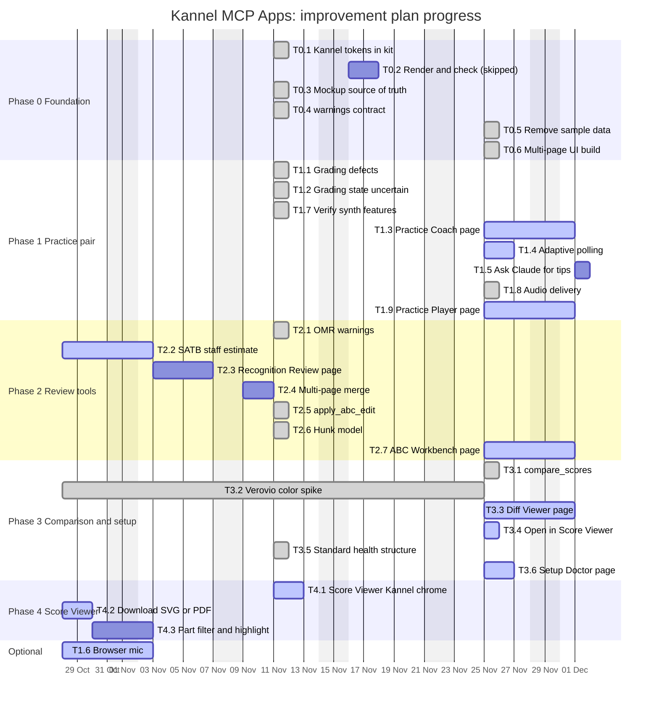

# MCP Apps improvement plan (after PR #192)

**last changed:** 2026-11-25
**source:** https://github.com/raulkivi/sheet-music-mcp

**Status:** Partially implemented (updated 2026-11-25): 15 tasks done, 11 active, 4 not started, and
1 skipped. Server-side contracts and foundation work are in place, and the
Score Viewer is the only app page shipped. The other six app pages are not built. Input: Kannel
interactive mockups merged in
[#192](https://github.com/raulkivi/sheet-music-mcp/pull/192) (`docs/design/interactive/`), the visual
system in [docs/design/design-system.md](../design/design-system.md), and the gap review of the
server tools and apps. Owner decisions are recorded in [§6](#6-owner-decisions).

---

## 1. Summary

- Only one app page is shipped: the Score Viewer. Practice Coach, Practice Player, Recognition
  Review, ABC Workbench, Diff Viewer, and Setup Doctor still have no page under `ui/apps/`.
- Server-side contracts exist for the six app areas. All six servers register Setup Doctor
  resources, but the shared Setup Doctor page is not built.
- The mockups are clickable, but they hard-code sample data and some behaviour the engines do not
  yet provide. Building them as-is would ship fake issues, fake states and a fake meter.
- Kannel tokens are in the kit and the Score Viewer uses theme-aware chrome. Its planned tricolor
  bar, 40 px touch targets, PDF download, and part filter/highlight are still missing.
- The interactive design boards still contain sample data and have not been rendered and checked in
  a browser. The Score Viewer app itself has automated browser coverage.
- Implemented server-side work includes grading fixes and state reporting, OMR warnings and staff
  estimates, ABC edits and the hunk helper, and the shared health report. Their app pages remain open.

**Order:** make the mockups honest and the tokens real (Phase 0), then build the practice pair
(Phase 1, the P0 apps), then the review tools that depend on new server contracts (Phase 2), then the
comparison and setup pages (Phase 3).

---

## 2. Baseline

| App | Server | Server side | Mockup (#192) | Page in `ui/apps/` | Blocking gaps |
|---|---|---|---|---|---|
| Score Viewer | render-mcp | `render_page_svg` app-only; `render_to_pdf` / `render_to_image` linked | Yes | **Shipped** | Theme-aware Kannel tokens, focus ring, paging, fullscreen and SVG download/fallback exist. Still missing the tricolor bar, 40 px controls, PDF download, and part filter/highlight |
| Practice Coach | pitch-mcp | `get_score_for_session`, pushed-audio mode and `push_audio_chunk`, `list_sessions`, `start_practice`; grading fixes and `uncertain` / `no_signal` states | Yes | No | Page, adaptive polling, report/tips flow, and browser AudioWorklet capture are not built |
| Practice Player | synth-mcp | `read_audio_chunk`, `get_score_xml`, `part_gains`, `starting_pitches` | Yes | No | Page and browser chunk-to-Blob loader are not built; server-side audio reads exist |
| Recognition Review | omr-mcp | `structuredContent`, `warnings[]`, `staff_systems_estimate`, `get_recognized_score`, `get_source_preview` | Yes | No | Page is not built; mock issues remain sample data; staff estimate still needs real-sample integration evidence |
| ABC Workbench | musicxml-abc-mcp | `get_abc`, `validate_abc`, `apply_abc_edit`; shared hunk model in the UI kit | Yes | No | Page and live validation/accept flow are not built |
| Diff Viewer | comparer-mcp | Structured comparison results, `list_changes`, `export_annotated_musicxml` | Yes | No | `compare_scores` (C24) is not exposed and the page is not built; Verovio MusicXML note-color support is verified |
| Setup Doctor | all six | Standard structured `health_check` report and `ui://<server>/setup-doctor` resource on all six servers | Yes (one board) | No | Shared Setup Doctor page is not built; each server must show only its own checks |

---

## 3. Mockup-to-code gaps

These must be settled before a page is built. Each row is a place where the mockup promises
behaviour the server or the design system does not support.

| # | App | Mockup shows | Reality or rule | Resolution |
|---|---|---|---|---|
| G1 | Recognition Review | Issue list: "Bar 12, alto: three notes read" hard-coded, "Re-run with this engine" | OMR now returns `warnings[]`; the page must render server warnings, not sample issues | T2.1 supplies warnings; bind the page to them |
| G2 | Recognition Review | "Audiveris (keeps SATB)" as a fixed choice | OMR now returns `metadata.staff_systems_estimate`; real-sample validation remains open | Show only data-derived estimates/warnings; page not built |
| G3 | Practice Coach | Statuses `ok / flat / slip` ("Octave slip", "Flat on beat 3") | The three grading defects are fixed; `uncertain` / `no_signal` states are available | Map real server states; do not label uncertain results as a confident "slip" |
| G4 | Practice Coach | Simulated meter cycle; sample bar 9–12 | No binding to `get_current_position` / `push_audio_chunk` | Real adaptive polling (D7); remove the cycle |
| G5 | Practice Coach | No mic-source choice | Decision D2: server mic (A) first, browser mic (B) later | Add a source selector; default to server mic |
| G6 | Practice Coach | No "Ask Claude for tips", no report mode | Plan §5.1 Report mode and `ui/message` | Add both (T1.4) |
| G7 | Practice Player | Parts are on/off toggles; tempo copy says "re-renders the track" | Server supports part gains/presets; plan is solo / mute / volume (D3), local tempo first (`playbackRate`), re-render only on voice change | Page not built; use the existing server controls and local tempo |
| G8 | Practice Player | Loop "bars 17 to 24" hard-coded; tempo 50–120 BPM with 84 as written | `measures` and `tempo_factor` 25–400% exist as contracts | Page not built; bind loop to `measures` and use the server's tempo range |
| G9 | Practice Player | Count-in toggle | `count_in_bars` is implemented and was verified in T1.7 | Wire it in the page or omit the control |
| G10 | ABC Workbench | Single hunk, "Valid ABC" text fixed | The pure hunk merge helper exists; live validation and page flow do not | T2.6 is done; T2.7 must call live `validate_abc` and show actual results |
| G11 | ABC Workbench | Accept "writes MusicXML" | `apply_abc_edit` and `abc_to_musicxml` exist; path policy (A1) determines delivery | Page not built; use `return: auto` and show a file chip |
| G12 | Diff Viewer | "Open in Score Viewer" implies a direct link | Apps cannot call other servers (spec §2) | Post `ui/message`; the model chains (decision DA8) |
| G13 | Diff Viewer | Kinds: Pitch, Rhythm, Lyrics, Dynamics | Kinds must match the comparer's real diff model; Articulation is absent | Take kinds from `structuredContent`, not a fixed list |
| G14 | Setup Doctor | One board for render, synth, omr | All six servers register their own `ui://<server>/setup-doctor` resource | Shared page not built; implement one component with per-server data (DA5) |
| G15 | Score Viewer | "Download SVG" | Owner decision DA2: offer both SVG and PDF | SVG download/fallback exists; add PDF delivery |
| G16 | All | Two mockup sets: `docs/design/mockups/` (static) and `interactive/` | Duplicated, will drift | One source of truth (DA1) |
| G17 | All | Kannel tokens, tricolor, focus ring | Tokens are in the kit; Score Viewer has theme-aware styling and a focus ring | T0.1 is done; finish the Score Viewer tricolor bar and 40 px targets, then adopt the kit in new pages |
| G18 | All | Sample data inline | Must come from tool results or `structuredContent` | Remove sample data before shipping |
| G19 | All | Icons: cornflower, waveform "reserved, not drawn" | Design system §6 | Draw or drop before release |
| G20 | All | No reduced-motion behaviour in mocks | Design system §5 requires it | Add in each page (X1) |

---

## 4. Work plan

Each task has a complexity (low / medium / high) and the model it should run on. Test-first is
mandatory: each task starts with the failing test named in its acceptance column.

**Model rule:** Haiku for mechanical edits, Sonnet for typical feature work, Opus for cross-cutting
design or tricky logic. **Local model (setup6)** is used only where the rules in `CLAUDE.md` allow:
at most three files, an exact spec, acceptance tests the local agent does not see, and no domain
judgement. Local runs are marked "local candidate"; they are verified outside the VM.

### Phase 0: foundation (no new pages)

| ID | Task | Cx | Model | Local | Files | Acceptance (test first) |
|---|---|---|---|---|---|---|
| T0.1 | Adopt Kannel tokens in the kit (`theme.ts`, D3). Separate change: it moves Score Viewer contrast tests. | M | Sonnet | Candidate | `ui/packages/kit/src/theme.ts`, its test | `brand-tokens.test.ts` and `theme-contrast.test.ts` pass with the new values; Score Viewer e2e unchanged |
| T0.2 | Render all eight Kannel boards in a browser (Design runtime `support.js`), run axe and the contrast pairs, record results in the mockup README. | M | Sonnet | No | `docs/design/interactive/README.md` | Zero axe serious/critical issues per board; contrast pairs in §3.1 of the design system hold |
| T0.3 | Settle the mockup source of truth (DA1) and mark the other set as archived or generated. | S | Haiku | Yes | docs only | One README states the canonical set; links updated |
| T0.4 | Document the `warnings[]` contract (`{code, severity, message, measure?, part?}`) in `docs/conventions.md`. Needed by G1. | S | Sonnet | No | `docs/conventions.md` | Contract reviewed; used by T2.1 |
| T0.5 | Remove sample data from the mockups, keep the shape of each `structuredContent` as a fixture. | S | Haiku | Yes | `docs/design/interactive/*.dc.html` (≤3 per run) | Each board renders from a fixture file only; no inline sentences that look like data |
| T0.6 | Multi-page UI build: one registry (`ui/apps.config.mjs`) drives the vite build, `check-html`, `copy-assets`, the mock host (`?app=<name>`) and `publish.yml`. Added 2026-11-25 (§6 DA11). | M | Sonnet | No | `ui/` build scripts, mock host, workflows | Registry unit tests; Score Viewer e2e unchanged |

### Phase 1: practice pair (P0)

**Practice Coach (pitch-mcp)**

| ID | Task | Cx | Model | Local | Files | Acceptance |
|---|---|---|---|---|---|---|
| T1.1 | Fix the three open grading defects (octave slip, vibrato on held final note, long voiced tail). Remove the xfail markers when fixed. | H | Opus | No | `pitch-mcp` engine and grading tests | Existing xfail tests pass; no regression in 482 unit tests |
| T1.2 | Expose a grading state `uncertain` / `no_signal` in `get_current_position` and `structuredContent` (G3). | M | Sonnet | Candidate | `pitch-mcp` engine, presenter, tests | Test: low-confidence frame returns `uncertain`, never `slip` |
| T1.3 | Practice Coach page: score cursor from `get_score_for_session`, meter, Start / Stop, Report mode from `stop_monitoring` summary. Mic source selector (server mic, A). | H | Sonnet | No | `ui/apps/practice-coach/*` | Vitest: cents → needle, status map, history. Playwright on mock host: AC-P5 (cursor visits bars in order; meter color per status); axe clean; 360 px; keyboard |
| T1.4 | Adaptive polling 5–10 Hz (D7); animate between samples; pause on hidden tab. | M | Sonnet | No | page polling module | Unit: back-off when median RTT > 80 ms; no request while hidden |
| T1.5 | "Ask Claude for tips" via `ui/message`; `update-model-context` on stop (G6). | S | Haiku | Candidate | page + 1 helper | Mock host records one `ui/message` with fixed template text (no MusicXML free text) |
| T1.6 | Browser mic (B): `AudioSource` protocol, `PushedChunkSource`, AudioWorklet capture. Phase 3 of the proposal; behind feature detection. | H | Opus | No | `pitch-mcp` engine, page | AC-P4 (220 Hz push → `on_pitch`); permission denied → falls back to A |

**Practice Player (synth-mcp)**

| ID | Task | Cx | Model | Local | Files | Acceptance |
|---|---|---|---|---|---|---|
| T1.7 | Verify `part_gains` presets (`learning`, `karaoke`, `equal`) and `measures`, `repeat`, `count_in_bars`, `timbre` in code; list what is missing (G9). | S | Haiku | Yes | none (report) | Written list in this doc §7 |
| T1.8 | Audio delivery: `read_audio_chunk` loop into a Blob; `audio_id` from `structuredContent`. | M | Sonnet | Candidate | page loader module | AC-S3: concatenated chunks byte-equal to WAV; unknown id → `INVALID_PARAMETER` |
| T1.9 | Practice Player page: solo / mute / volume per part (G7), tempo via `playbackRate` (`preservesPitch`), re-render on voice change, loop bound from `measures` (G8), playhead from Verovio timemap. | H | Sonnet | No | `ui/apps/practice-player/*` | AC-S5 (tempo 0.5 → loop start at 2× score time); AC-S1 engine test (CC7 = 0 for muted part); Playwright mock host; axe; reduced motion (playhead jumps by measure) |

### Phase 2: review tools (depend on server contracts)

**Recognition Review (omr-mcp)**

| ID | Task | Cx | Model | Local | Files | Acceptance |
|---|---|---|---|---|---|---|
| T2.1 | Emit `warnings[]` from `recognize_sheet*` (C4) using T0.4 contract. | M | Sonnet | Candidate | `omr-mcp` presenter, tests | Test: parts < staves produces a `warnings` entry; no warnings on a clean fixture |
| T2.2 | SATB detection: `metadata.staff_systems_estimate` (cheap staff-line projection). | H | Opus | No | `omr-mcp` image code, fixtures | AC-O3 fixture (`staves_detected: 1`, estimate 4 → warning shown). Integration on real samples (not in this container) |
| T2.3 | Recognition Review page: photo via `get_source_preview`, score via `get_recognized_score` + Verovio, engine switch → `recognize_sheet` with `engine`, issue list from `warnings[]` (G1), accept → `ui/message`. | H | Sonnet | No | `ui/apps/recognition-review/*` | AC-O1/AC-O2 (server); AC-O3 (UI); no hard-coded issues; axe |
| T2.4 | Multi-page reorder and merge (plan U3). Decide DA9 first. | M | Sonnet | No | page + merge call | Page order persists in model context; merge calls `recognize_sheets` once |

**ABC Workbench (musicxml-abc-mcp)**

| ID | Task | Cx | Model | Local | Files | Acceptance |
|---|---|---|---|---|---|---|
| T2.5 | `apply_abc_edit` (C16): replace measures of one part, keep other parts byte-for-byte. | H | Opus | No | `musicxml-abc-mcp` engine, tests | Round trip: other parts and dynamics unchanged; invalid bar range → `INVALID_PARAMETER` |
| T2.6 | Hunk model: pure TS merge of original and proposed lines; accept selected / reject all (G10). | M | Sonnet | Candidate | `ui/packages/kit/src/abc/hunks.ts`, test | AC-A1: accept all = proposed; accept none = original |
| T2.7 | ABC Workbench page: original via `get_abc(abc_id)`, proposed from tool input, live `validate_abc` at 300 ms, accept → `abc_to_musicxml`, file chip (G11). | H | Sonnet | No | `ui/apps/abc-workbench/*` | AC-A3 error marker within 500 ms; no fixed "Valid ABC" text; axe |

### Phase 3: comparison and setup

**Diff Viewer (comparer-mcp)**

| ID | Task | Cx | Model | Local | Files | Acceptance |
|---|---|---|---|---|---|---|
| T3.1 | Decide and expose the consolidated tool (C24 `compare_scores`) with aliases for one minor release. | M | Sonnet | No | comparer server, conventions | Old names still pass their tests; new tool has `output_schema` (AC-C1) |
| T3.2 | Spike: does Verovio apply MusicXML `color` on notes? If not, CSS on element ids. | S | Sonnet | No | spike script, findings note | Recorded answer in the proposal's open questions |
| T3.3 | Diff Viewer page: list from `structuredContent`, kind filters from the real model (G13), selection scrolls both panes, Report tab, export annotated scores. | H | Sonnet | No | `ui/apps/diff-viewer/*` | AC-C3 (click m.19 scrolls both panes); Playwright; axe; stack at 360 px |
| T3.4 | "Open in Score Viewer" posts `ui/message` (G12). | S | Haiku | Yes | page + 1 helper | Mock host records one `ui/message` |

**Setup Doctor (all servers)**

| ID | Task | Cx | Model | Local | Files | Acceptance |
|---|---|---|---|---|---|---|
| T3.5 | Standard `health_check` structure `{status, checks:[{name,status,version?,hint?,fix_snippet?,doc_url?}]}` in `sheet_music_mcp_core.health` and each server. | M | Sonnet | No | core `health.py`, six servers | Existing health tests pass; `output_schema` validates for all six |
| T3.6 | One Setup Doctor page built in core, fed by each server's own checks (G14). Copy report via `clipboardWrite`; install links via `ui/open-link`. | M | Sonnet | Candidate (page part) | `sheet-music-mcp-core` ui, page | Each server's `ui://<server>/setup-doctor` renders its own checks; axe; no cross-server claims |

### Phase 4: shipped Score Viewer and cross-cutting

| ID | Task | Cx | Model | Local | Files | Acceptance |
|---|---|---|---|---|---|---|
| T4.1 | Score Viewer chrome to Kannel: tricolor bar, focus ring, 40 px touch targets, theme tokens (after T0.1). | M | Sonnet | Candidate | `ui/apps/score-viewer/*` | Existing e2e green; new check for the tricolor and ring (design §9) |
| T4.2 | Download: SVG (mock) or PDF via `get_pdf` (DA2). | M | Sonnet | No | render-mcp server, page | PDF bytes start with `%PDF`; blob download fallback posts `ui/message` (D6) |
| T4.3 | Part filter and highlight (render `parts`, C6b) in the viewer. | M | Sonnet | No | render-mcp engine, page | AC-R3 paging; highlight dims other parts |
| X1 | Reduced motion, `aria-live` on cents and status, keyboard for every control. Added to each page task's spec, not a separate phase. | S | Haiku | Yes | page CSS, specs | Playwright with `reducedMotion: 'reduce'` |

---

## 5. Sequencing

| Step | Items | Exit criterion |
|---|---|---|
| 1 | T0.1–T0.5 | Tokens in kit; mockups rendered and checked; no sample data in mockups |
| 2 | T1.1, T1.2 (pitch engine) in parallel with T1.7, T2.1 | Grading state honest; warnings exist |
| 3 | T1.3–T1.5, T1.8, T1.9 | Practice pair running in the mock host |
| 4 | T2.2, T2.3, T2.5–T2.7 | Recognition review and ABC workbench in mock host |
| 5 | T3.1–T3.6, T4.x | Diff viewer, setup doctor, Score Viewer chrome |
| 6 | T1.6, T2.4 | Browser mic and multi-page (optional, after owner review) |

Each step ends with the full suites of the servers it touched, and the UI specs for each page. Server
docs are updated per the document policy in `CLAUDE.md` when a step lands.

### 5.1 Gantt chart

Durations are working days (weekends excluded). Bars are planned dates; once a task starts or
finishes, its tag and dates change to actuals (see §5.3). Start date is the planned kick-off.

### 5.2 Progress tracker

Status values: **Not started**, **Active**, **Done**, **Blocked** (with the blocker in Notes).
Dates are YYYY-MM-DD. Update this table with the Gantt chart after every step.

| ID | Task | Status | Started | Done | Notes |
|---|---|---|---|---|---|
| T0.1 | Kannel tokens in kit | Done | 2026-11-11 | 2026-11-11 | PR #194; kit tokens and theme tests landed |
| T0.2 | Render and check boards | Skipped | | | Owner skipped local browser/axe checks; the published Design canvas is not a substitute for the planned validation |
| T0.3 | Mockup source of truth | Done | 2026-11-11 | 2026-11-11 | DA1 confirmed; `docs/design/interactive/README.md` names the canonical set and supersedes `mockups/` |
| T0.4 | warnings contract | Done | 2026-11-11 | 2026-11-11 | Contract is documented in `docs/conventions.md` and used by OMR results |
| T0.5 | Remove sample data | Done | 2026-11-25 | 2026-11-25 | PR #214: each board reads an inline copy of `docs/design/interactive/fixtures/<board>.json`; pitch states are the server's. Boards not rendered (no `support.js`) |
| T0.6 | Multi-page UI build | Done | 2026-11-25 | 2026-11-25 | PR #212: `ui/apps.config.mjs` registry; 300 unit, 64 e2e |
| T1.1 | Grading defects | Done | 2026-11-11 | 2026-11-11 | PR #203 (#200 now merged; CI 23/23 after timing-flake fix bf32be3 and rebase onto main). xfail 4 → 0; 509 unit. Real-mic release evidence (PM1/PM2) still pending |
| T1.2 | Grading state uncertain | Done | 2026-11-11 | 2026-11-11 | PR #200, 494 passed. The owner accepted the YIN 0.6 and octave 100-cent thresholds on 2026-11-11 |
| T1.3 | Practice Coach page | Active | 2026-11-25 | | DA7: server microphone is the v1 default; built with T1.4 on `feat/ui-practice-coach` |
| T1.4 | Adaptive polling | Active | 2026-11-25 | | With T1.3 |
| T1.5 | Ask Claude for tips | Not started | | | |
| T1.6 | Browser mic (optional) | Active | 2026-10-28 | | Server-side pushed sessions and app-only `push_audio_chunk` exist; browser AudioWorklet capture and page are not built |
| T1.7 | Verify synth features | Done | 2026-11-11 | 2026-11-11 | Report only, §7. All features exist |
| T1.8 | Audio delivery | Done | 2026-11-25 | 2026-11-25 | PR #215: kit `loadAudio`; written by local setup6 in one run, 11 hidden acceptance tests passed |
| T1.9 | Practice Player page | Active | 2026-11-25 | | DA3/DA4: presets and per-part volume; local `playbackRate` first; `feat/ui-practice-player` |
| T2.1 | OMR warnings | Done | 2026-11-11 | 2026-11-11 | PR #198, 318 passed. Fewer-parts-than-staves warnings are informational and returned for all clients |
| T2.2 | SATB staff estimate | Active | 2026-10-28 | | `staff_systems_estimate` is implemented with unit coverage; real-sample integration evidence remains |
| T2.3 | Recognition Review page | Not started | | | |
| T2.4 | Multi-page merge (optional) | Not started | | | DA9: excluded from v1; optional future work |
| T2.5 | apply_abc_edit | Done | 2026-11-11 | 2026-11-11 | PR #201, 306 unit + 6 integration. CI 23/23; the security notes were fixed in PR #204 |
| T2.6 | Hunk model | Done | 2026-11-11 | 2026-11-11 | PR #197, CI 24/24 pass, 283 unit tests |
| T2.7 | ABC Workbench page | Active | 2026-11-25 | | `feat/ui-abc-workbench` |
| T3.1 | compare_scores | Done | 2026-11-25 | 2026-11-25 | PR #213: `compare_scores(detail=summary\|changes\|report\|full)` with `output_schema`; five old tools are deprecated aliases; comparer 387 unit, 7 integration |
| T3.2 | Verovio color spike | Done | 2026-10-28 | 2026-11-25 | Verovio applies MusicXML `color` to noteheads; proposal §5.4 synced in PR #214 |
| T3.3 | Diff Viewer page | Active | 2026-11-25 | | DA8: use `ui/message` to hand off to the Score Viewer; with T3.4 on `feat/ui-diff-viewer` |
| T3.4 | Open in Score Viewer | Active | 2026-11-25 | | With T3.3 |
| T3.5 | Standard health structure | Done | 2026-11-11 | 2026-11-11 | Already on main via PR #178 (merged). Verified: core `health.py`, six servers return it with `output_schema`. No new PR |
| T3.6 | Setup Doctor page | Active | 2026-11-25 | | DA5: one page per server's own checks; `feat/ui-setup-doctor` |
| T4.1 | Score Viewer Kannel chrome | Active | 2026-11-11 | | Theme tokens and focus ring exist; tricolor bar and 40 px targets remain |
| T4.2 | Download SVG or PDF | Active | 2026-10-28 | | SVG and fallback exist; PDF download remains (DA2: offer both) |
| T4.3 | Part filter and highlight | Not started | | | |

### 5.3 Update rule

After every implementation step, before the next step starts:

1. Set each finished or started task's status in §5.2 and fill **Started** and **Done** with actual dates.
2. Mirror the status in §5.1: add `done` (finished) or `active` (in progress) to the task's tag, and
   replace its planned dates with actuals where they differ. If a task slips, move its `after` link
   or durations so the chart shows the real critical path.
3. Add a line to the log in §5.4: date, step, tasks, test result (suites run and counts), blockers.
4. Bump **last changed** in the header.
5. If scope changed, record it in §6 (decision) and reflect it in the Gantt and tracker in the same edit.

### 5.4 Progress log

| Date | Step | Tasks | Result | Blockers |
|---|---|---|---|---|
| 2026-11-11 | Plan created | none | Gantt and tracker added | none |
| 2026-11-11 | Phase 0 step 1 | T0.1, T0.3, T0.4 | Implemented on separate branches, reviewed. ui: 270 unit, 61/61 e2e; docs reviewed | Branches not yet merged |
| 2026-11-11 | Phase 1–2 batch 1 | T1.7, T2.1, T2.6 | T1.7 report (§7). T2.1 PR #198 (318 passed, 48 skipped). T2.6 PR #197 (283 passed). Open: T2.1 changes the staff estimate to run for all clients, with false positives on one-staff pages | T2.1 decision needed |
| 2026-11-11 | Batch 2 results | T2.1 fix, T1.2, §10, T2.5 | PR #198 severity now `info` (ff07c0d). T1.2 PR #200 (494 passed, 4 xfail kept). §10 docs PR #199. T2.5 PR #201 (306 unit, 6 integration; other parts byte-identical on 10 SATB samples). Open: T1.2 thresholds (YIN 0.6, octave 100 cents) need review; T2.5 open questions (bar-count strictness, lyrics carry-over, multi-staff `<staff>`); `musicxml_to_abc` drops `=` naturals (B natural exports as B flat) | T1.2 thresholds, T2.5 questions, naturals bug |
| 2026-11-11 | Interview decisions | T2.1, T1.9, T4.2 | Staff check: all clients, severity `info` (PR #198 to change). Practice Player: presets + per-part volume (DA3). Download: PDF and SVG (DA2). Next batch: T2.5, §10 docs PR, T1.2 | none |
| 2026-11-11 | PR #201 fix | T2.5 | Scan failed on a literal U+FEFF in `abc_edit.py`. Replaced with the `\ufeff` escape (commit 5e7c7b9). CI 23/23 pass. Security LOW notes left open | none |
| 2026-11-11 | Follow-up round | PR #203, PR #204 | #203: CI 3.13 failed on a timing flake (`idle_seconds` 0.0 vs 0.1), fixed with a frozen clock in the golden test (bf32be3); merged main into the branch (CLAUDE.md conflict, pitch row kept from branch, abc row from main); CI 23/23. #204: #201 security LOW notes fixed (fixed parse message, MAX_ABC_CHARS 65536, MAX_EDIT_BARS 64); CI 23/23. Plan doc contained a literal U+FEFF from an earlier edit, replaced with the escape | Real-mic evidence; review #203 and #204 |
| 2026-11-11 | T1.1 result | T1.1 | PR #203 (stacked on #200): three defects fixed, 4 xfail → 0. Review: it also edits the root CLAUDE.md status row, and changes detector and aligner logic; real-mic run needed for release | real-mic evidence; #200 merge |
| 2026-11-11 | Naturals fix | `musicxml_to_abc` naturals (not a plan ID) | PR #202: writes `=` for naturals; 237 unit passed, 3 of 4 new tests failed before fix; one golden line changed; one existing test expectation updated | none |
| 2026-11-11 | T3.5 check | T3.5 | Already implemented on main via #178 (merged). No new work; T3.6 Setup Doctor page is now unblocked | none |
| 2026-11-11 | Interview 2 | naturals bug, T1.2, T2.5, next batch | Naturals bug: fix now, own PR. T1.2 thresholds: accept as is. T2.5: strict bar count, multi-staff as a whole, key/time/clef ignored in ABC; lyrics carry-over not chosen. Next: T1.1, T3.5, naturals; T1.3 waits for #200 merge; T2.2 needs real samples | none |
| 2026-11-11 | Owner answers | DA1, T0.2 | DA1 confirmed (`interactive/` canonical). T0.2 skipped (no `support.js`). §10 link change pending owner go-ahead | none |
| 2026-11-24 | Status reconciliation | T1.6, T2.2, T3.2, T4.1–T4.3, baseline | Checked plan claims against current server code, tests, findings, and `ui/`: updated completed/partial work; only Score Viewer exists as a page; other app pages remain unbuilt | Browser capture, real-sample OMR integration, PDF download, and remaining app pages |
| 2026-11-25 | Batch 1 | T0.5, T0.6, T1.8, T3.1, T3.2 | PRs #212 (ui 300 unit, 64 e2e), #213 (comparer 387 unit, 7 integration), #214 (docs), #215 (ui 306 unit; setup6 first run) merged. T0.6 added: the build was hard-wired to one page | none |
| 2026-11-25 | Batch 2 started | T1.3, T1.4, T1.9, T2.7, T3.3, T3.4, T3.6 | Five page agents (Sonnet), one branch each | none |

---

## 6. Owner decisions

The decisions below were confirmed by the owner on 2026-11-11; they are no longer open questions.

| # | Decision | Recorded resolution |
|---|---|---|
| DA1 | Which mockup set is canonical: `docs/design/interactive/` or `docs/design/mockups/`? | `interactive/`; archive the static set |
| DA2 | Score Viewer download: SVG (mockup) or PDF (proposal `get_pdf`)? | Offer both: PDF for print, SVG for web |
| DA3 | Practice Player: solo/mute/volume with presets (proposal), or on/off toggles (mockup)? | Proposal: presets plus per-part volume |
| DA4 | Tempo: re-render on every change (mockup copy) or local `playbackRate` first (proposal)? | Local first; re-render only on voice change |
| DA5 | Setup Doctor: one board for all servers (mockup) or per server (proposal)? | Per server (the MCP Apps rule does not allow cross-server calls) |
| DA6 | Ship Estonian UI labels? (design system D4) | Ship English first; Estonian after the labels are final |
| DA7 | Practice Coach mic source for v1: server mic (A) only? | Yes, A only; B in Phase 4 |
| DA8 | Diff Viewer "open in Score Viewer": `ui/message` (chain through model). | Yes |
| DA9 | Recognition Review multi-page in v1? | No; single page first, multi-page in T2.4 |
| DA10 | Icons cornflower and waveform: draw now or drop? | Draw the waveform (Practice Player); drop the cornflower unless used |
| DA11 | Scope change 2026-11-25 (coordinator, not an owner decision): add T0.6 (multi-page UI build) before the page tasks | Added; one registry entry per page so parallel page branches do not conflict |

---

## 7. Remaining verification

- T1.7 result (2026-11-11, read-only, code not run): all synth features exist.
  - `part_gains`, `preset` (`learning`, `karaoke`, `equal`) with `focus_part`, `measures`, `repeat` (1–20), `count_in_bars` (0–4), `metronome`, `tempo_factor`, `starting_pitches` (`parts`).
  - `timbre` enum is `score` (default), `piano`, `choir`, `organ`. `score` is not in the mockup's list; the page must send one of the four.
  - `read_audio_chunk` and `get_score_xml` are app-only. Not verified that the page is served them.
- Tests were not run for the read-only T1.7 feature audit; the T1.8 loader (`loadAudio`) is merged.
- `start_practice` and `list_sessions` exist server-side; verify their use when the T1.3 page is built.
- T1.6 still needs browser-side AudioWorklet capture and the permission-denied fallback.
- T2.2 still needs the planned integration check on real samples.

## 8. Rules applied

- TDD: each task names its first failing test.
- SOLID and CUPID: pure functions for cents mapping, hunk merge, meter state; pages take data through
  `structuredContent` and tool results only.
- UI behaviour automated first (`ui/` Playwright or Vitest). Manual host checks only where a real
  host is needed (CSP, iframe sandbox, device timing).
- Opaque handles, never paths, in app-only tools. Cross-server flows go through `ui/message`.
- Every new page ships a spec file in `apps/<page>/e2e/` (`ui/README.md`, U8).
- Local model runs: setup6 only for the rows marked "Candidate", one run at a time, verified outside the VM.

## 9. Out of scope

- Android, web PoC and the all-in-one distribution (A3).
- Official use of the Estonian flag or arms (design system D5).
- Visual regression screenshots (design system D6).
